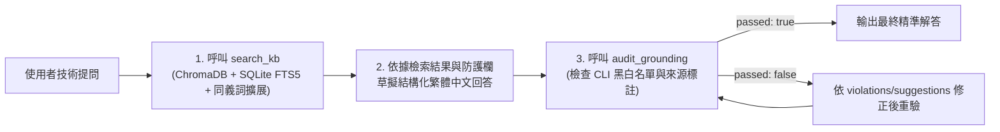

# 通用 RAG 雙軌檢索與原廠引述稽核指南

本技能定義智能體透過 MCP 工具進行精準檢索與零幻覺輸出的標準作業流程：

## 標準閉環工作流

### 步驟 1：雙軌檢索 (`search_kb`)
* 調用 `search_kb(query="...", top_k=8)`。
* 工具會同時回傳「ChromaDB 語意相似度結果」與「SQLite FTS5 BM25 精確匹配結果」（包含 PDF 頁碼與網站完整 URL），以及當前產品的 `domain_guardrails`。

### 步驟 2：嚴格遵循來源標註草擬回答
* 每一條關鍵步驟與技術論點，均必須附帶檢索證據給出的原始來源標籤：
  * PDF 檔：`[來源: <檔名.pdf>, 第 <頁碼> 頁]`
  * 網站：`[來源: <完整網址 URL>]`

### 步驟 3：確定性防幻覺稽核 (`audit_grounding`)
* 在將結果呈現給使用者前，呼叫 `audit_grounding(query="...", draft_answer="...")`。
* 若回傳 `"passed": false`，必須依據 `violations` 與 `suggestions` 修正禁用詞或補齊出處標籤，再重新驗證通過。
