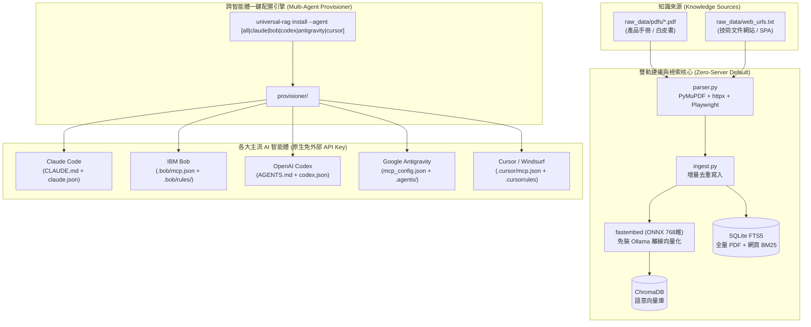

# 通用型多產品雙軌 RAG 知識庫與跨 Agent 工具 (`universal-rag-template`)

本專案是一套**產品無關、無本機絕對路徑硬編碼、開箱即可跨電腦與跨 AI 智能體部署**的企業級雙軌 RAG 檢索與工具套件。

原生支援 **Claude Code、OpenAI Codex、Google Antigravity、IBM Bob、Cursor、Windsurf** 等主流 AI 代理，並內建 **`universal-rag` 統一 CLI** 與 **Multi-Agent Provisioner**，能自動為不同 Agent 產生專屬的 MCP 設定與領域防護規則。

---

## 🏗️ 系統架構圖



---

## 🚀 跨 Agent 3 分鐘一鍵安裝指南

### 1. 取得專案並初始化環境

```bash
git clone https://github.com/Kuo1964/universal-rag-template.git
cd universal-rag-template
./scripts/setup.sh
```

`setup.sh` 會自動建立獨立虛擬環境、安裝相依套件（含離線 `fastembed` 768 維 ONNX 向量支援），新電腦**免安裝 Ollama，亦無需外部 LLM API Key**。

---

### 2. 為您的 AI Agent 一鍵註冊設定 (`universal-rag install`)

專案內建的 `cli.py`（或安裝後的 `universal-rag`）可自動為您使用的 Agent 產生專屬的 MCP 設定與防護規則：

```bash
# 為所有主流 Agent（Claude, Bob, Codex, Antigravity, Cursor）一次配置完成
.venv/bin/python cli.py install --agent all

# 或僅針對特定 Agent 配置：
.venv/bin/python cli.py install --agent claude        # 寫入 CLAUDE.md 與 claude.json
.venv/bin/python cli.py install --agent bob           # 寫入 .bob/mcp.json 與 .bob/rules/
.venv/bin/python cli.py install --agent codex         # 寫入 AGENTS.md 與 codex.json
.venv/bin/python cli.py install --agent antigravity   # 寫入 mcp_config.json 與 .agents/
.venv/bin/python cli.py install --agent cursor        # 寫入 .cursor/mcp.json 與 .cursorrules
```

---

### 3. 各 Agent 平台開箱即用說明

| AI 智能體 | 自動產生的檔案 | 使用方式 |
| :--- | :--- | :--- |
| **Claude Code** | `CLAUDE.md`、`claude.json`、`.claude/mcp.json` | 啟動 Claude Code 即自動識別工具；或手動執行 `claude mcp add universal-rag-kb -- ./scripts/run_mcp.sh` |
| **IBM Bob** | `.bob/mcp.json`、`.bob/rules/`、`.bob/skills/` | 使用 IBM Bob 開啟專案資料夾即可自動掛載，支援 `@mention` 技能 |
| **OpenAI Codex** | `AGENTS.md`、`codex.json` | 智能體啟動時自動載入 `AGENTS.md` 中的檢索與出處標註守則 |
| **Google Antigravity** | `mcp_config.json`、`AGENTS.md`、`.agents/rules/` | Antigravity 啟動時自動載入工具與規範手冊 |
| **Cursor / Windsurf** | `.cursor/mcp.json`、`.cursorrules`、`.windsurfrules` | 編輯器自動於背景啟動 MCP 工具，在對話中直接呼叫 `search_kb` |

---

## 🛠️ 統一命令列工具指南 (`cli.py` / `universal-rag`)

本專案除了作為 MCP 工具給 Agent 調用外，人類工程師亦可直接於終端機執行檢索、建庫與審計：

```bash
# 1. 雙軌檢索（終端直接查詢知識庫，輸出 PDF 頁碼與網頁出處）
.venv/bin/python cli.py search "叢集初始化與 Quorum 設定"

# 2. 統一建庫（支援 PDF 手冊與網站遞迴擷取）
.venv/bin/python cli.py ingest --mode all
.venv/bin/python cli.py ingest --mode web --add-url https://docs.example.com/guide/ --max-depth 2

# 3. 獨立啟動 MCP 伺服器
.venv/bin/python cli.py mcp

# 4. 防幻覺與出處標籤審計
.venv/bin/python cli.py audit --query "如何重開機" --answer "請執行 satask stopnode [來源: doc.pdf, 第 12 頁]"

# 5. 檢視知識庫統計狀態
.venv/bin/python cli.py stats
```

---

## 🔌 MCP 暴露工具一覽 (`mcp_server.py`)

| 工具名稱 | 是否需要外部 API Key | 功能說明 |
| :--- | :--- | :--- |
| `search_kb` | ❌ 不需要 | 執行 ChromaDB + SQLite FTS5 雙軌混合檢索（套用 Profile 同義詞擴展），回傳帶頁碼或 URL 的參考資料與防護欄。 |
| `audit_grounding` | ❌ 不需要 | 針對草稿回答執行確定性檢查：攔截 Profile `blocklist` 中的禁用/廢棄指令，並驗證來源標註完整性。 |
| `ingest_kb` | ❌ 不需要 | 在智能體對話中直接觸發 PDF 掃描或指定 `target_url` 網站遞迴擷取入庫。 |
| `get_kb_stats` | ❌ 不需要 | 查詢目前啟用之 Product Profile、可用設定檔列表、向量庫筆數與 FTS5 索引統計。 |
| `ask_expert` | ✅ 選配 | 若在 `.env` 填入 `GEMINI_API_KEY` 或 `OPENAI_API_KEY`，可直接呼叫後端獨立 RAG 推理引擎作答。 |

---

## ⚙️ 客製化產品設定檔 (`profiles/<name>.yaml`)

專案預設啟用 `profiles/default.yaml`（無任何特定產品限制）。您可以透過複製 `profiles/examples/ibm_flashsystem.yaml` 打造新產品線，並在 `.env` 中設定 `ACTIVE_PROFILE=<name>`：

* `synonyms`：定義技術縮寫與同義詞，自動提升雙軌檢索召回率。
* `cli_validation`：開啟後可設定官方指令 `allowlist` 與幻覺/廢棄指令 `blocklist` 替換建議。
* `domain_guardrails`：列出該產品線不可違反的物理或架構邊界。
* `crawler`：自訂網站擷取規則（`same_domain_only`、`same_path_prefix`、`url_allow_patterns` 等）。
