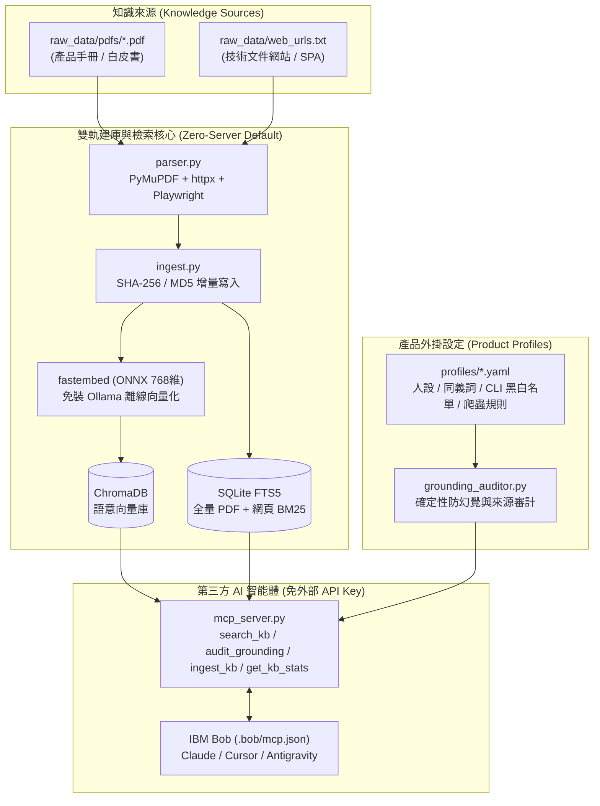

# 通用型多產品雙軌 RAG 知識庫引擎 (`universal-rag-template`)

本專案是一套**產品無關、無本機絕對路徑硬編碼、開箱即可跨電腦部署**的企業級雙軌 RAG 檢索與 MCP 工具引擎，專為 **IBM Bob**、Antigravity、Claude Desktop、Cursor 等第三方 AI 智能體設計。

核心設計結合了實戰驗證的 **ChromaDB 語意向量檢索 + SQLite FTS5 BM25 精確匹配** 雙軌架構、**PDF 手冊 + 網站遞迴擷取（含動態 SPA）** 雙源解析引擎，以及**宣告式產品 Profile (`profiles/*.yaml`) + 防幻覺稽核 (`audit_grounding`)**。

---

## 🏗️ 系統架構圖



---

## 🚀 新電腦 3 分鐘快速啟用指南

### 1. 取得專案並一鍵安裝環境

```bash
git clone <your-github-repo-url>
cd universal-rag-template
./scripts/setup.sh
```

`setup.sh` 會自動建立 `.venv` 虛擬環境、安裝相依套件（含離線 `fastembed` 向量模型支援）、並產生預設 `.env` 與資料目錄。

> **💡 免外部 API 金鑰優勢**：預設透過 `fastembed` 在本機計算 768 維向量，並透過 MCP 將檢索證據交給 **IBM Bob** 等智能體自身的大模型推理，因此**完全不需申請 Gemini/OpenAI API Key 或安裝 Ollama** 即可運作。

### 2. 匯入您的新產品知識庫（PDF + 網站擷取）

* **放入 PDF 手冊**：將任意產品的 PDF 檔案放入 `raw_data/pdfs/`。
* **加入官方文件網站**：將入口網址逐行寫入 `raw_data/web_urls.txt`（支援同網域遞迴爬取與動態 JavaScript SPA 網頁，並自動將內含的 PDF 連結下載入庫）。

執行統一增量建庫（同時處理網站與 PDF）：

```bash
# 同時掃描 raw_data/pdfs/ 與 raw_data/web_urls.txt
.venv/bin/python ingest.py --mode all

# 或直接從命令列加入一個新網站並立即遞迴擷取（最大深度 2 層、最多 50 頁）
.venv/bin/python ingest.py --mode web --add-url https://docs.example.com/product/ --max-depth 2 --max-pages 50
```

### 3. 在 IBM Bob 中導入並自動客製化新產品線

1. 直接使用 **IBM Bob** 開啟本專案資料夾。
2. Bob 會自動偵測並載入以下專案級配置：
   * `.bob/mcp.json`：透過 `./scripts/run_mcp.sh` 自動啟動 `Universal-DualTrack-RAG-KB` MCP 工具。
   * `.bob/rules/`：強制先檢索再回答、標註 PDF 頁碼或網頁 URL 來源，並執行輸出前稽核。
   * `.bob/skills/init-product-rag/` 與 `rag-grounding-verification/`：支援一鍵客製化新產品線與合規驗證閉環。
3. **一鍵客製化新產品設定**：在 IBM Bob 對話框直接輸入：
   > 請執行 `init-product-rag` 技能，分析 `raw_data/pdfs/` 與我的產品文件網站，為這個新產品建立專屬的 Profile YAML 與防護規則。

---

## 🔌 MCP 暴露工具一覽 (`mcp_server.py`)

| 工具名稱 | 是否需要外部 API Key | 功能說明 |
| :--- | :--- | :--- |
| `search_kb` | ❌ 不需要 | 執行 ChromaDB + SQLite FTS5 雙軌混合檢索（套用 Profile 同義詞擴展），回傳帶頁碼或 URL 的參考資料與防護欄。 |
| `audit_grounding` | ❌ 不需要 | 針對草稿回答執行確定性檢查：攔截 Profile `blocklist` 中的禁用/廢棄指令，並驗證來源標註完整性。 |
| `ingest_kb` | ❌ 不需要 | 在智能體對話中直接觸發 PDF 掃描或指定 `target_url` 網站遞迴擷取入庫。 |
| `get_kb_stats` | ❌ 不需要 | 查詢目前啟用之 Product Profile、可用設定檔列表、向量庫筆數與 FTS5 索引統計。 |
| `ask_expert` | ✅ 選配 | 若在 `.env` 填入 `GEMINI_API_KEY` 或 `OPENAI_API_KEY`，可直接呼叫後端獨立 RAG 推理引擎作答。 |

---

## ⚙️ 客製化產品設定檔 (`profiles/<name>.yaml`)

專案預設啟用 `profiles/default.yaml`（無任何產品限定詞）。您可以複製並修改出專屬產品線的 YAML（可參考企業級範例 [profiles/examples/ibm_flashsystem.yaml](profiles/examples/ibm_flashsystem.yaml)），並在 `.env` 中設定 `ACTIVE_PROFILE=<your_profile>`：

* `synonyms`：定義技術縮寫與同義詞，自動提升雙軌檢索召回率。
* `cli_validation`：開啟後可設定官方指令 `allowlist` 與幻覺/廢棄指令 `blocklist` 替換建議。
* `domain_guardrails`：列出該產品線不可違反的物理或架構邊界。
* `crawler`：自訂網站擷取規則（`same_domain_only`、`same_path_prefix`、`url_allow_patterns`、`auto_download_pdfs` 等）。

---

## 🌐 選配：啟動獨立 Web Portal 與推上新 GitHub Repo

```bash
# 若需獨立執行網頁檢索 / API 服務（預設 Port 8888）
.venv/bin/python web_app.py

# 若要將此資料夾作為獨立專案推送到新的 GitHub Repo
git init
git add .
git commit -m "feat: initialize universal dual-track RAG template"
```
